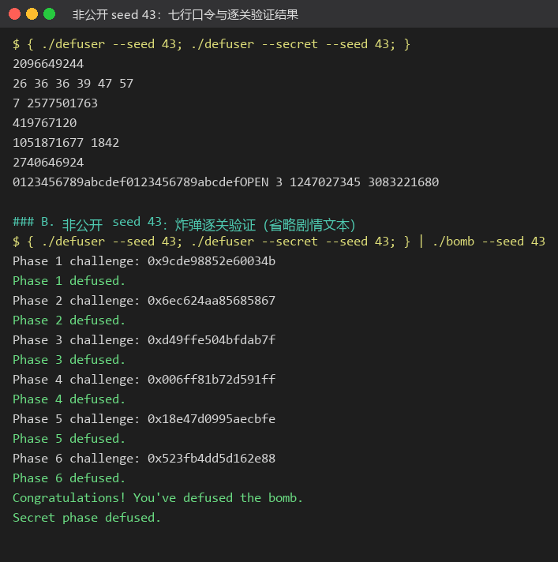
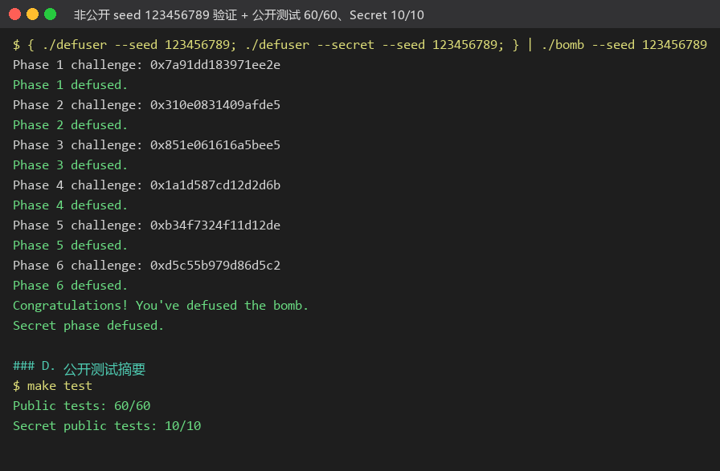

# Lab2：BombLab 实验报告

| 项目 | 内容 |
| --- | --- |
| 姓名 / GitHub | Mount-B |
| 学号 | 25300680098 |
| 个人仓库 | https://github.com/Mount-B/ics-2026-bomblab |
| 实验环境 | Windows 11 + WSL2 Ubuntu 26.04.1 LTS（`uname -sm` = `Linux x86_64`），gcc 15.2.0、GNU gdb 17.1、objdump 2.46 |
| 完成情况 | 正式六关 + Honor 全部通过；`make test` → `Public tests: 60/60`、`Secret public tests: 10/10` |

## 一、分析方法

1. **静态导出汇编**：`objdump -d --no-show-raw-insn --disassemble=phase_01 ./bomb > phase_01.S`，逐关阅读控制流；关卡调用的辅助函数也一并导出，不只读入口函数。
2. **在线核对**：`gdb ./bomb` → `break *phase_01` → `run --seed 42 --phase 1 < input.txt`，在函数入口用 `set $challenge = $rsi` 把 challenge 存进 GDB 的便利变量（`rsi` 之后会被改写），再到关键的 `cmp` 处用 `p/u`、`x/…` 核对寄存器与栈上的值是否与静态推断一致。**全程只用观察，没有用 `set` 修改炸弹的寄存器或内存。**
3. **先表单、后关系**：先用 `sscanf` 的格式串确定每关要几个整数，再恢复"challenge → 每个整数"的计算关系。本实验是参数化炸弹，答案随 challenge 变化，因此每关都写成对任意 challenge 成立的表达式。
4. **验证**：`./defuser --seed S --phase N | ./bomb --seed S --phase N` 逐关看 `Phase N defused.`；再跑 `public_test.py` 与若干公开列表以外的 seed（第 5 节）。

本题的 challenge 是 64 位，但各关只用到它的若干位段，因此代码里统一先取出需要的部分再按 32 位无符号运算（汇编里都是 `eax`/`esi` 这类 32 位寄存器，32 位加、减、乘按模 2³² 回绕）。

## 二、总体结果



*图 1：非公开 seed 43 下 `defuser` 生成的七行口令，以及把七行输入炸弹后的逐关结果（`Phase 1..6 defused.` 与 `Secret phase defused.`；为便于截图省略了剧情文本与 ASCII 画）。*



*图 2：另一个非公开 seed 123456789 的验证，以及 `make test` 的摘要 `Public tests: 60/60`、`Secret public tests: 10/10`。*

## 三、逐关分析

### 第 1 关：函数调用与返回值（单整数）

```asm
phase_01:  call 402050 <p1_compute>      ; p1_compute(challenge)
           cmp  %eax,-0x14(%rbp)         ; 与输入的整数比较
           sete %al
p1_compute:
  40205b:  shr  $0x20,%rax               ; hi = challenge >> 32
  402064:  shr  $0x10,%rsi               ; mid = challenge >> 16
  40206b:  call 402030 <p1_step1>
  402072:  mov  %edx,%edi                ; (uint32)challenge
  402076:  call 402020 <p1_step0>
  40207f:  call 402040 <p1_step2>
p1_step0:  sub %esi,%edi ; lea 0xee0c(%rdi,%rdi,4),%eax    ; 5*(a-b)+0xee0c
p1_step1:  lea (%rdi,%rsi,2),%eax ; xor $0xbe4b,%eax       ; (x+2y)^0xbe4b
p1_step2:  xor $0x746,%esi ; lea (%rsi,%rdi,2),%eax        ; 2a+(b^0x746)
```

**推理**：`p1_compute` 把 challenge 拆成三份——高 32 位 `hi`、`challenge>>16`、低 32 位 `lo`。三次调用之间，`edi`/`esi` 一直是"上一次的参数"，因为 `p1_step1` 只写 `eax`（`lea` 和 `xor` 都不改源寄存器），所以第二、三次调用的实参可以从寄存器传递关系直接读出。

**计算关系**（全部 32 位无符号）：

```c
hi = (uint32)(c >> 32);  mid = (uint32)(c >> 16);  lo = (uint32)c;
t1 = (hi + 2*mid) ^ 0xbe4b;
t0 = 5*(lo - hi) + 0xee0c;
answer = 2*t0 + (t1 ^ 0x746);
```

### 第 2 关：数组、循环与递推（六个整数）

`sscanf` 的格式串是 `0x40317a` 处的 `"%u %u %u %u %u %u"`，六个整数是栈上从 `-0x40(%rbp)` 起连续排列的数组（`mov -0x40(%rbp,%rdx,4),%esi` 印证了这一点）。

```asm
  402160:  shr  $0x2e,%rax       ; c >> 46
  402164:  and  $0x1f,%eax       ; & 31
  402167:  add  $0x2,%eax        ; +2  → v[0]
  40216e:  mov  $0xb,%ecx        ; cl = 11
  402173:  mov  $0x1,%edx        ; i = 1
  402178:  mov  %r13,%rax
  40217b:  shr  %cl,%rax         ; c >> (11+2*(i-1))
  40217e:  and  $0xf,%eax        ; & 15
  402181:  add  %esi,%eax        ; + v[i-1]
  402187:  xor  %edx,%eax        ; ^ i
  402189:  cmp  %eax,%esi        ; 与 v[i] 比较
  402191:  add  $0x2,%ecx        ; cl += 2
  402194:  cmp  $0x6,%rdx        ; i != 6 继续
```

**推理**：第 0 个整数由 `c>>46` 的低 5 位加 2 得到；随后循环用 `cl` 从 11 开始每次加 2（即取 challenge 的 4 位一段），把上一项累加进来再与下标异或。这是一个"逐项递推"的伪随机序列，第 i 项依赖第 i−1 项，所以必须按顺序算。

```c
v[0] = ((c >> 46) & 31) + 2;
for (i = 1; i <= 5; i++)
    v[i] = ((((c >> (11 + 2*(i-1))) & 15) + v[i-1]) ^ i);
```

### 第 3 关：switch 分支与跳转表（两个整数）

```asm
  402301:  and  $0x7,%edi          ; sel = (uint32)c & 7
  402304:  cmp  %edi,-0x18(%rbp)   ; v[0] == sel
  40230c:  shr  $0x3,%rax
  402313:  shr  $0x20,%rsi
  402317:  xor  %eax,%esi          ; x = (c>>32) ^ (c>>3)
  402319:  call 402250 <p3_dispatch>
p3_dispatch:
  402258:  cmp  $0x7,%eax
  40225d:  notrack jmp *0x405820(,%rax,8)     ; 8 项跳转表
```

跳转表放在 `0x405820`，用 GDB 读出 8 项后得到真实分支顺序（**这是本题最容易错的地方：表项顺序和 `p3_case_N` 的编号并不一致**）：

| sel | 0 | 1 | 2 | 3 | 4 | 5 | 6 | 7 |
|---|---|---|---|---|---|---|---|---|
| 表项指向 | case_3 | case_1 | case_5 | case_7 | case_2 | case_0 | case_4 | case_6 |

各分支体（`%edi` 是 `esi` 传进来的 `x`）：

```asm
case_0: lea 0xcf31(%rdi,%rdi,2),%eax     ; 3x+0xcf31
case_1: lea 0x0(,%rdi,4),%eax ; xor $0x67f6,%eax   ; 4x^0x67f6
case_2: lea 0xa23(%rdi,%rdi,4),%eax      ; 5x+0xa23
case_3: shr $0x2,%edi ; xor $0xa178,%eax ; add %edi,%eax  ; (x^0xa178)+(x>>2)
case_4: lea 0x8363(%rdi,%rdi,4),%eax     ; 5x+0x8363
case_5: lea 0x0(,%rdi,4),%eax ; xor $0x78af,%eax   ; 4x^0x78af
case_6: lea 0xac86(%rdi,%rdi,2),%eax     ; 3x+0xac86
case_7: shr $0x2,%edi ; xor $0xcd,%al ; add %edi,%eax  ; (x^0xcd)+(x>>2)
```

**推理**：`x` 由挑战的高 32 位与 `c>>3` 异或得到；`sel` 就是低 3 位。注意 `case_7` 里的 `xor $0xcd,%al` 只改 `eax` 的最低字节，但 `0xcd < 0x100`，效果等价于整字异或 `0xcd`。

```c
sel = (uint32)c & 7;  x = (uint32)(c >> 32) ^ (uint32)(c >> 3);
v[0] = sel;  v[1] = f_sel(x);   // f 见表
```

### 第 4 关：递归调用与返回过程（单整数）

```asm
p4_walk:                         ; p4_walk(target, lo, hi, acc)
  402338:  sub  %esi,%edi
  40233a:  shr  $1,%edi          ; (hi-lo)/2
  40233c:  add  %esi,%edi        ; mid = lo + (hi-lo)/2
  40233e:  cmp  %eax,%edi
  402340:  je   402390           ; mid == target → 基例
  40234e:  cmp  %edi,%eax
  402350:  jb   402370           ; target < mid
  402352:  lea  0x1(%rdi),%esi   ; lo = mid+1
  402357:  call 402330 <p4_walk>
  40235c:  lea  (%rax,%rax,4),%eax   ; 5*ret
  40235f:  xor  %ebx,%eax            ; ^ (mid+acc)
  402366:  xor  $0xe,%eax            ; ^ 0xe     （target > mid 分支）
  402370:  lea  -0x1(%rdi),%edx  ; hi = mid-1
  402384:  xor  $0xc,%eax            ; ^ 0xc     （target < mid 分支）
  402390:  lea  0xf3(%rdi),%eax
  402396:  xor  %ecx,%eax            ; (mid+0xf3) ^ acc   基例
```

**推理**：这是一个**二分查找**的递归：区间 `[lo,hi]`、中点 `mid`，目标与中点比较后向一侧递归。回溯时把子结果乘 5、异或 `(mid+acc)`、再异或一个随方向变化的常数（向右 0xe、向左 0xc）。基例是 `mid == target`，返回 `(mid+0xf3) ^ acc`。注意比较用 `jb`（无符号）。

```c
walk(target, lo, hi, acc):
    mid = lo + (hi-lo)/2;
    if (mid == target) return (mid + 0xf3) ^ acc;
    if (target > mid) return (5*walk(target, mid+1, hi, acc) ^ (mid+acc)) ^ 0xe;
    else              return (5*walk(target, lo, mid-1, acc) ^ (mid+acc)) ^ 0xc;
target = (uint32)c & 0x7f;                       // 入参：edi = target
lo = 0; hi = 0x7f;                               // esi = 0, edx = 0x7f
acc  = (uint32)(c >> 7) ^ (uint32)(c >> 32);     // ecx
```

### 第 5 关：结构体布局与链表遍历（两个整数）

```asm
p5_traverse:                     ; p5_traverse(challenge, &out)
  40242d:  and  $0x7,%eax
  402434:  mov  0x405b60(,%rax,8),%rdx    ; head = p5_heads[c & 7]
  402447:  mov  0x8(%rdx),%esi            ; f8 = node->f8
  40244c:  xor  0xc(%rdx),%eax            ; acc ^= node->fc
  402451:  xor  $0x49f1,%eax
  402456:  mov  %esi,(%r8)                ; *out = f8
  402459:  add  %esi,%eax                 ; acc += f8
  40245b:  and  $0x3,%edi                 ; skip = (c>>3) & 3
  402465:  mov  (%rdx),%rdx               ; node = node->next
  40246e:  xor  0xc(%rdx),%eax
  402471:  add  %esi,%eax
  402473:  mov  %esi,(%r8)                ; *out = 当前节点的 f8
```

**推理**：每个节点 16 字节：`[+0] next` 指针、`[+8]` 与 `[+0xc]` 两个 32 位字段。`p5_heads`（`0x405b60`）是 8 个链表头，`p5_nodes`（`0x405ba0`）是节点数组。用 GDB 把这两处内存读出来（`x/8gx 0x405b60`、`x/24gx 0x405ba0`），把指针换算成下标后得到：

```text
节点(下标): next  f8     fc          链表头: idx0..7 →
0: 7    337   9088          8,3,2,1,4,6,7,10   (按地址 0x405c00, bd0, bc0, bb0, ba0, c10, c20, c40)
1: 0   2439  12993
2: 1     73  46315
3: 2   2914  39157
4: 5   1842  24181
5: 9   1664  37241
6: 3   2576  15531
7: 8   1354  33826
8: 10  1090    631
9: -1   568  36377      ← 链尾
10: 11 2080  55427
11: 4   817  18508
```

`v[0]` 是累加值，`v[1]` 是**最后访问的那个节点**的 `f8`——这也是唯一需要"记住上次的值"的地方，因为 `*out = f8` 在循环里每次都会被覆盖。

```c
idx = c & 7;  skip = (c >> 3) & 3;
n = heads[idx];
acc = (uint32)(c >> 6) ^ (uint32)(c >> 32) ^ nodes[n].fc ^ 0x49f1;
acc += nodes[n].f8;
for (i = 0; i < skip; i++) { n = nodes[n].next; acc ^= nodes[n].fc; acc += nodes[n].f8; }
v[0] = acc;  v[1] = nodes[n].f8;
```

### 第 6 关：函数指针表与间接调用（单整数）

```asm
p6_dispatch:
  40258c:  shr  $0x6,%rdi
  402590:  mov  %rbx,%rax
  402593:  shr  $0x20,%rax
  402597:  xor  %eax,%edi        ; x = (c>>6) ^ (c>>32)
  4025a0:  and  $0x38,%ebx       ; ebx = c & 0x38（第 2 次调用的字节偏移）
  4025a3:  and  $0x7,%eax        ; eax = c & 7
  4025a6:  call *0x405e00(,%rax,8)    ; ops[c & 7](x)
  4025ad:  xor  $0x2acb,%eax
  4025b4:  call *0x405e00(%rbx)       ; ops[(c & 0x38) >> 3](上一步结果)
  4025bf:  add  $0xa9fb,%eax
```

`0x405e00` 处的表用 GDB 读出：`op_0, op_2, op_5, op_5, op_3, op_1, op_4, op_3`（注意 `op_5`／`op_3` 各出现两次，`p6_op_*` 的编号与表下标并不对应）。

```asm
p6_op_0: xor $0x3abc,%eax ; shl $0x7,%edi ; add %edi,%eax   ; (x^0x3abc)+(x<<7)
p6_op_1: shr $0x3,%eax ; xor %edi,%eax ; add $0xfe9d,%eax   ; ((x>>3)^x)+0xfe9d
p6_op_2: lea (%rdi,%rdi,4),%edx ; shl $0x7,%eax ; add $0xa0c1,%eax ; xor %edx,%eax
                                                            ; ((x<<7)+0xa0c1)^(5x)
p6_op_3: lea 0xdb07(%rdi),%eax ; shr $0x2,%edi ; xor %edi,%eax ; (x+0xdb07)^(x>>2)
p6_op_4: ror $0x2,%eax                                       ; ror(x,2)
p6_op_5: rol $0x5,%eax ; xor $0x9782,%eax                    ; rol(x,5)^0x9782
```

**推理**：这是"两次查表、中间夹一层常量"的结构——第一次用低 3 位选函数，第二次用 `(c & 0x38) >> 3` 选函数（`and $0x38` 直接当字节偏移用，所以下标天然是 0..7）。返回值先异或 `0x2acb` 再送进第二个函数，最后加 `0xa9fb`。

```c
x = (uint32)(c >> 6) ^ (uint32)(c >> 32);
y = ops[c & 7](x) ^ 0x2acb;
answer = ops[(c & 0x38) >> 3](y) + 0xa9fb;
```

## 四、Honor（第七关）

Honor 的入口是 `secret_gate`，它先把整行 `strcpy` 进一个 164 字节的栈缓冲区，再检查两件事：

```asm
secret_gate:
  40275c:  call strlen
  402761:  sub  $0x24,%rax        ; len - 36
  402765:  cmp  $0x7f,%rax
  402769:  jbe  402780            ; 36 <= len <= 163 才继续
  40278b:  cmpl $0x4e45504f,-0xb0(%rbp)   ; 缓冲区偏移 +32 处 == "OPEN"
  40279d:  lea  -0xac(%rbp),%rdi          ; 偏移 +36 的指针
  4027a4:  call 402640 <secret_phase>     ; secret_phase(buf+36, challenge, context)
```

- `0x4e45504f` 小端就是 `'O','P','E','N'`，位于 `缓冲区+32`，也就是**输入行的第 32..35 字节**（`secret_copy` 是逐字节 `strcpy`，整行原样搬进缓冲区，所以行内偏移即缓冲区偏移）。
- 长度必须落在 `[36,163]`：至少能放下 32 字节前缀 + "OPEN" + 至少一个数字，又不能溢出缓冲区。

`secret_phase(buf+36, challenge, context)` 再用 `"%u %u %u"` 解析出三个整数 `A B C`：

```asm
  4026a0:  mov  %r13d,%ecx ; and $0x3,%ecx   ; A = (uint32)context & 3
  4026a8:  cmp  %ecx,-0x2c(%rbp)             ; A == ecx
  4026b0:  imul $0xe9d3,%ecx,%r9d            ; r9 = A*0xe9d3
  4026ba:  shr  $0x20,%rsi                   ; challenge >> 32
  4026c2:  xor  %r12d,%esi                   ; mix = (c>>32) ^ (uint32)c
  4026c5:  xor  %r13d,%r8d                   ; ctx = (ctx>>32) ^ (uint32)ctx
  4026c8:  shr  $0x10,%r13                   ; context >> 16
  4026ce:  xor  %r13d,%r9d                   ; r9 ^= (uint32)(context>>16)
  4026d1:  xor  %r8d,%edi                    ; arg = mix ^ ctx
  4026d4:  call 402630 <secret_mix>
  4026d9:  xor  %r9d,%eax
  4026dc:  cmp  %eax,-0x28(%rbp)             ; B == secret_mix(arg) ^ r9
  4026e1:  shr  $1,%esi                      ; mix >> 1
  4026e3:  lea  0x6b8f(%r8,%rcx,1),%edx      ; 0x6b8f + ctx + A
  4026eb:  add  %esi,%edx
  4026ef:  cmp  -0x24(%rbp),%eax             ; C
secret_mix: mov %edi,%eax ; ror $1,%eax ; xor $0x825c,%eax
```

**计算关系**：

```c
A = (uint32)context & 3;
mix = (uint32)(challenge >> 32) ^ (uint32)challenge;
ctx = (uint32)(context >> 32)  ^ (uint32)context;
key = (A * 0xe9d3) ^ (uint32)(context >> 16);
arg = mix ^ ctx;
B = (ror32(arg, 1) ^ 0x825c) ^ key;
C = B ^ (0x6b8f + ctx + A + (mix >> 1));
```

第七行 = `32 字节前缀 + "OPEN" + " " + A + " " + B + " " + C`。我用 `0123456789abcdef0123456789abcdef`（正好 32 字节）当前缀，`OPEN` 恰好落在偏移 32，第 36 字节起是三个十进制整数。

`solve_secret` 的 `context` 参数由驱动用前六关的口令算出并传入，因此不需要自己重算；`challenge` 参数就是 Honor 自己的 challenge。验证时用文档给的写法：

```bash
{ ./defuser --seed 42; ./defuser --secret --seed 42; } | ./bomb --seed 42
```

运行末尾出现 `Secret phase defused.` 即通过。

## 五、非公开 seed 的验证记录

公开测试用的 seed 是 `0, 1, 7, 42, 99, 123, 2026, 65535, 987654321, 18446744073709551615`。除了这些，我另外用 **43、123456789** 各做了一次"七行一起过"的完整验证（图 1、图 2），每一关的结果都是 `defused`：

| seed | 第 1–6 关 | Honor |
| --- | --- | --- |
| 43 | 全部 `defused` | `Secret phase defused.` |
| 123456789 | 全部 `defused` | `Secret phase defused.` |

此外开发过程中还用过 42、7、65535 等 seed 反复对照 GDB 观察值，确认计算关系对不同的位段取值都成立（例如第 2 关的 `cl` 从 11 递增到 19、第 3 关的 8 个分支都被不同的 `c & 7` 覆盖到）。

## 六、资料与工具使用说明

- **参考资料**：CS:APP 第 3 章（x86-64 汇编、过程调用与栈帧）、课程实验文档的 GDB 教学部分、CS:APP 的 x86-64 GDB 速查表、`objdump`/`gdb` 自带帮助（`help` / `info address`）。
- **GDB 用法**：只在函数入口和关键 `cmp`/`call` 处停下来观察；用 `set $challenge = $rsi` 保存入口参数、用 `x/8gx` 读跳转表与链表数据。**没有任何用 `set` 修改程序数据来绕过检查的操作。**
- **AI 工具使用说明**：本实验使用了 AI 编码助手（DeepSeek Harness）辅助：导出与阅读反汇编、整理跳转表/链表数据、把结论写成 `defuser.c` 里的求解函数、以及起草本报告的结构与文字。所有计算关系我都用 GDB 在关键指令处核对过，并用多个 seed 与公开测试验证；提交的代码与结论由我本人负责，我能逐行解释每一关的推导。

## 七、感想与建议

- 最大的体会是"**跳转表和函数指针表必须去内存里读，不能靠 `p3_case_N` 的编号猜**"——第 3 关的表项顺序和第 6 关的重名表项都藏了这个坑，如果按符号名顺序假设，前 10 个公开 seed 可能全对，但换一组 challenge 就会挂。参数化炸弹把"背答案"彻底堵死了，只能老老实实恢复函数关系。
- 第 5 关让我第一次真切理解"结构体布局"：`mov 0x8(%rdx),%esi` 和 `xor 0xc(%rdx),%eax` 这种写法直接暴露了 16 字节的节点结构，而"最后访问的节点"这个细节只能从 `mov %esi,(%r8)` 的位置看出来。
- 建议：可以在文档里加一句"跳转表/函数指针表要用 GDB 读内容，表项顺序可能和符号名顺序不一致"的提示；另外 `public_test.py --phase N` 逐关跑比 `make test` 快得多，适合调试阶段用。
